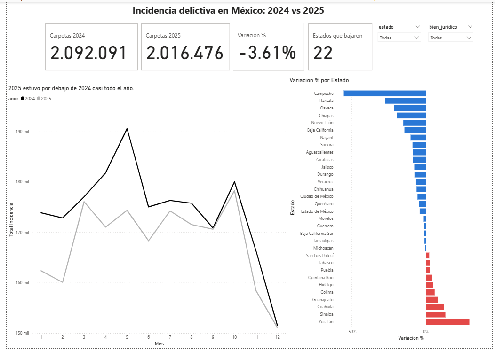
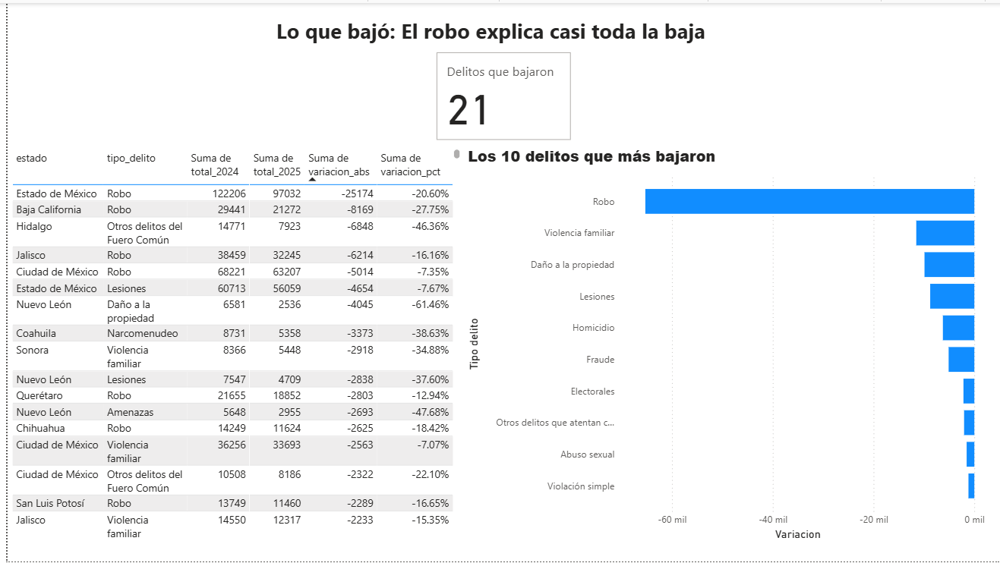
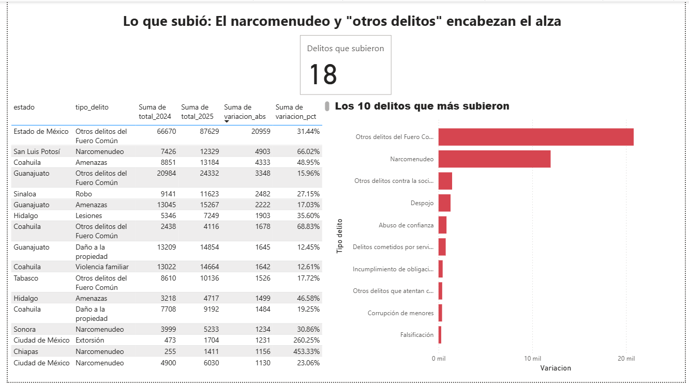

# Incidencia delictiva en México: ¿qué bajó y qué subió en 2025?

Análisis de datos abiertos del gobierno de México con **Python (pandas)** y **Power BI**.
Comparo 2025 contra 2024 por estado y por tipo de delito, y separo los resultados en **positivos** (la incidencia bajó) y **negativos** (la incidencia subió).



---

## Hallazgos

| Indicador | 2024 | 2025 | Cambio |
|---|---:|---:|---:|
| Carpetas de investigación (nacional) | 2,092,091 | 2,016,476 | **−75,615 (−3.6 %)** |
| Estados donde bajó | | | **22 de 32** |
| Estados donde subió | | | **10 de 32** |

- **La incidencia bajó 3.6 %** a nivel nacional. Bajó en 22 estados y subió en 10.
- **El robo explica casi toda la baja:** −65,276 carpetas, alrededor del 86 % de la caída nacional.
- **Campeche tuvo la mayor baja porcentual (−55 %)**, pero conviene tomarla con cautela: casi todos sus delitos cayeron a menos de la mitad en un solo año (robo −75 %, lesiones −63 %, violencia familiar −57 %). Eso apunta más a un cambio en el registro que a una baja real.
- **Puebla subió 2.6 % (+2,117)**, impulsado por fraude (+17 %), daño a la propiedad, robo y falsificación, que se duplicó (+117 %). Lesiones y homicidio bajaron.
- **El narcomenudeo subió 13 % (+11,954)**. Este delito se registra cuando la policía detiene a alguien, no por denuncia de una víctima, así que un aumento puede reflejar más operativos y no necesariamente más venta.

---

## Preguntas que respondí

**1. ¿Qué estado mejoró más en porcentaje? ¿Es creíble?**
Campeche, con −55.1 % (de 12,434 a 5,580 carpetas), seguido de Tlaxcala (−27.3 %) y Oaxaca (−21.4 %). La baja de Campeche merece dudas: que todos los delitos caigan a menos de la mitad en un solo año es poco probable y sugiere un cambio en cómo se registran las denuncias.

**2. ¿Qué delito explica la mayor parte de la baja nacional?**
El robo: −65,276 carpetas de una baja total de −75,615 (≈ 86 %). Le siguen violencia familiar (−11,521) y daño a la propiedad (−9,889).

**3. ¿Qué pasó en Puebla?**
Subió 2.6 % (+2,117). Los delitos que más aumentaron fueron fraude (+729), daño a la propiedad (+491), robo (+414) y falsificación (+362, más del doble). Los que más bajaron fueron lesiones (−397) y homicidio (−230).

**4. ¿Por qué el narcomenudeo puede subir aunque no haya más venta?**
Porque no depende de denuncias. La mayoría de los delitos se registran cuando una víctima denuncia; el narcomenudeo se registra cuando la policía detiene a alguien con droga. Más operativos significan más registros, aunque la venta sea la misma.

---

## Dashboard en Power BI

| Resumen | Positivos (bajó) | Negativos (subió) |
|---|---|---|
|  |  |  |

Archivo: [`powerbi/incidencia_delictiva_mx.pbix`](powerbi/)

Código de color en todo el reporte: **azul = bajó (positivo)**, **rojo = subió (negativo)**. Se eligió azul/rojo en lugar de verde/rojo para que sea legible para personas con daltonismo.

---

## Datos

- **Fuente:** Secretariado Ejecutivo del Sistema Nacional de Seguridad Pública (SESNSP), *Incidencia delictiva del fuero común, nivel estatal*, publicado en [datos.gob.mx](https://www.datos.gob.mx/dataset/incidencia_delictiva).
- **Descarga directa:** https://repodatos.atdt.gob.mx/api_update/sesnsp/incidencia_delictiva/INM_estatal_dic25.csv
- **Archivo:** `INM_estatal_dic25.csv` — 413,952 filas, enero 2015 a diciembre 2025, 32 estados, 40 tipos de delito.
- **Ventana de análisis:** enero 2024 a diciembre 2025 (75,264 filas).

---

## Proceso

```
CSV crudo (data/raw/)
      │
      ▼  scripts/limpieza_y_filtro.py
      │    1. Carga y recorte a 2024-2025
      │    2. Limpieza: mes en número, fecha, nombres de columnas
      │    3. Comparativo 2025 vs 2024 por estado, por delito y por estado + delito
      │    4. Clasificación: positivo (bajó) / negativo (subió) / sin cambio
      ▼
Tablas limpias (data/processed/)
      │
      ▼
Power BI (modelo estrella + medidas DAX)
```

**Validaciones:** sin valores nulos, sin filas duplicadas, 12 meses completos por año y 32 entidades.

**Regla de clasificación:**
`variación = total 2025 − total 2024` → menor que 0 = **Positivo (bajó)** · mayor que 0 = **Negativo (subió)** · igual a 0 = Sin cambio.
"Positivo" significa bueno para la población (menos delitos), aunque el número de la variación sea negativo.

La columna `base_suficiente` marca los casos donde 2024 tuvo al menos 30 carpetas, para no sacar conclusiones de porcentajes con bases muy pequeñas (pasar de 2 a 6 casos es +200 %).

**Reproducible:** al borrar `data/processed/` y volver a correr el script, se regeneran exactamente las mismas tablas.

---

## Limitaciones

1. Son **carpetas de investigación** (denuncias formales ante el Ministerio Público), no víctimas ni el total de delitos. La mayoría de los delitos no se denuncian.
2. Son **cifras absolutas**, no tasas por 100 mil habitantes. Para comparar estados de distinto tamaño conviene usar el porcentaje de cambio.
3. Un cambio puede deberse a cómo se denuncia o registra, no solo a cambios reales en la delincuencia (ver el caso de Campeche).
4. El SESNSP actualiza y corrige sus cifras cada mes; este análisis usa el corte con datos a diciembre de 2025.

---

## Cómo reproducirlo

1. Descarga el CSV desde el enlace de la sección **Datos** y guárdalo en `data/raw/`.
2. Instala las dependencias y corre el script desde la carpeta raíz del proyecto:

```bash
pip install -r requirements.txt
python scripts/limpieza_y_filtro.py
```

3. Abre `powerbi/incidencia_delictiva_mx.pbix` en Power BI Desktop y actualiza los datos.

---

## Estructura

```
Incidencia-delictiva-mx/
├── data/
│   ├── raw/            # CSV oficial (no se sube a GitHub)
│   └── processed/      # tablas limpias para Power BI
├── notebooks/          # exploración y preguntas
├── scripts/
│   └── limpieza_y_filtro.py
├── powerbi/            # archivo .pbix
├── docs/img/           # capturas del dashboard
├── requirements.txt
└── README.md
```

## Herramientas

Python · pandas · NumPy · Jupyter · Power BI Desktop · DAX · Power Query · Git

---

**Autor:** Marco Daniel Gómez Pérez
